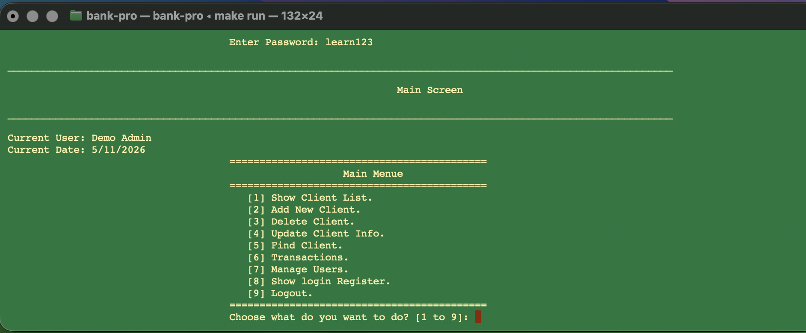
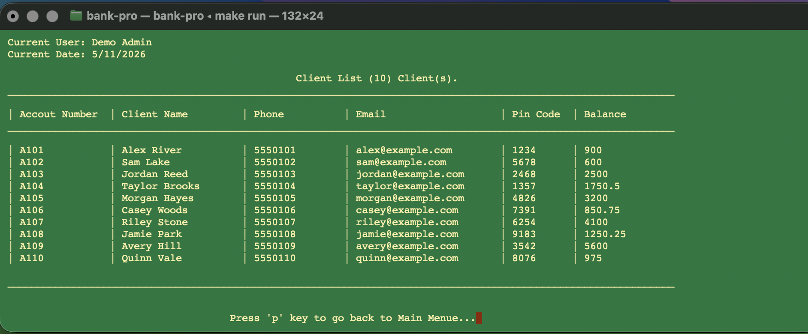
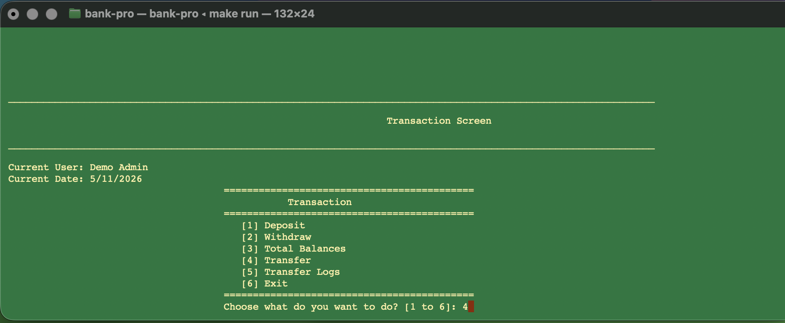
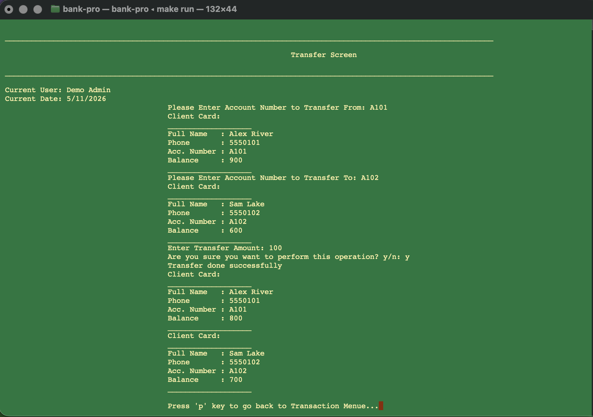
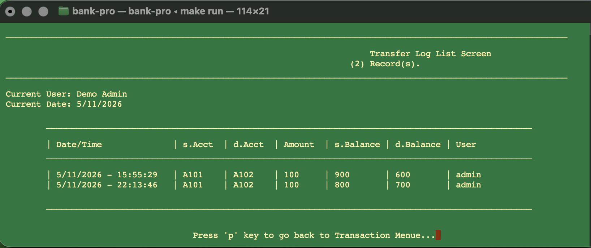

# bank-pro

**A console banking application I built as part of my journey learning object-oriented programming in C++.**

I built bank-pro to put my understanding of classes, objects, and their relationships into practice in a complete application. It brings client management, account transactions, staff permissions, and activity logs together in one interactive program, supported by utility libraries for strings, dates, input validation, and common operations.

This repository showcases my work and the OOP concepts I applied along the way. It reflects my current progress, including design decisions and limitations I can revisit as my C++ skills develop.

## Features

- **Client management:** add, find, update, delete, and list clients.
- **Transactions:** deposit, withdraw, transfer between accounts, and view total balances.
- **User management:** manage staff accounts and assign access permissions.
- **Authentication:** log in, log out, and limit failed login attempts.
- **Activity history:** view successful logins and completed transfers.
- **File persistence:** save records between sessions using simple text files.

## Screenshots

These captures show the application running with fictional demo data, from the main menu through a completed transfer and its history.

### Main menu

The central menu brings client management, transactions, staff accounts, and login history together after authentication.



### Client list

The client list displays ten fictional accounts with their contact details and balances in a tabular console layout.



### Transactions

The transaction menu groups deposits, withdrawals, total balances, account transfers, and transfer logs.



### Account transfer

This capture shows a confirmed transfer of **100** from `A101` to `A102`. The balances change from **900 → 800** and **600 → 700**, respectively.



### Transfer history

Saved transfer records show the timestamp, source and destination accounts, amount, resulting balances, and staff username.



## How I applied OOP

The application gave me a way to connect OOP concepts to concrete responsibilities, from representing a client to separating screen interactions from record storage.

| OOP concept | Where it appears |
| --- | --- |
| Classes and objects | `BankClient` models a bank client; `clsUser` models a staff account. |
| Encapsulation | Private fields hold account and personal information. Public methods expose operations such as `Save()`, `Deposit()`, and `Transfer()`. |
| Inheritance | `BankClient` and `clsUser` inherit personal details from `person`. Screen classes reuse `clsScreen` functionality. |
| Abstraction | Screens request operations through model methods without implementing record serialization themselves. |
| Function overloading | `Find(accountNumber)` and `Find(accountNumber, pinCode)` offer different ways to find a client. Utility functions also overload operations for different types. |
| Constructors | Derived classes initialize shared person fields and their own account or user fields. |
| Static methods | Lookup functions and screen entry points can be called without creating screen objects. |
| Object state | Enums represent empty, new, and existing records and guide saving behavior. |

The project demonstrates compile-time overloading. It does not implement runtime polymorphism through virtual functions or abstract base classes.

Beyond OOP, I used vectors, enums, references, file streams, bitwise permission checks, and menu-driven control flow to connect the application's features.

## Requirements

- A C++20-capable compiler: GCC, Clang, or MSVC.
- CMake 3.16 or newer for the standard build, or Make for the macOS/Linux alternative.
- A terminal. VS Code is optional.

There are no third-party application libraries or runtime scripts. The result is a native C++ executable.

## Quick start

Download or clone the repository, then open a terminal in the `bank-pro` directory:

```sh
cmake -S . -B build
cmake --build build --config Debug
cmake --build build --config Debug --target run
```

The `run` target starts the app from the project root so it can locate `data/`.

Log in with the included demo account:

| Username | Password | Access |
| --- | --- | --- |
| `admin` | `learn123` | All features |

### macOS and Linux alternative

If a compiler and Make are already installed:

```sh
make
make run
```

To select a compiler explicitly, use `make CXX=clang++` or `make CXX=g++` on the first build. The Makefile is intended for macOS and Linux.

### Windows

Install CMake and either the MSVC C++ build tools or a MinGW-w64 GCC toolchain. For MSVC, use a Developer PowerShell/Command Prompt so the compiler is available, then run the quick-start commands.

For MinGW-w64 with `g++` and `mingw32-make` on `PATH`, configure with:

```powershell
cmake -S . -B build -G "MinGW Makefiles"
cmake --build build
cmake --build build --target run
```

Use a fresh build directory when changing generators or compilers.

### Run the executable directly

Run these commands **from the project root**:

```sh
# macOS / Linux
./build/bank-pro
```

```powershell
# Windows with the Visual Studio generator
.\build\Debug\bank-pro.exe

# Windows with MinGW Makefiles
.\build\bank-pro.exe
```

The program reads and writes `data/` relative to the working directory. Keep that directory available and writable. If you move the project, configure a fresh build directory in its new location.

## Use with VS Code

1. Open the **bank-pro folder itself** with **File → Open Folder**.
2. Install the recommended **C/C++** and **CMake Tools** extensions.
3. Make sure a compiler and CMake are installed and available in the terminal.
4. Run **CMake: Select a Kit** if prompted to choose a compiler.
5. Use **Terminal → Run Build Task** to configure and compile.
6. Use **Terminal → Run Task → bank-pro: run** to interact with the application.

The included tasks build the application entry point with all required header directories. Use them instead of compiling whichever header or example happens to be open in the editor. You can also run the quick-start commands in VS Code's integrated terminal.

## Application flow

```text
Login
└── Main menu
    ├── Client list / Add / Delete / Update / Find
    ├── Transactions
    │   ├── Deposit / Withdraw
    │   ├── Total balances
    │   ├── Transfer
    │   └── Transfer logs
    ├── Manage users
    ├── Login register
    └── Logout
```

The demo dataset contains ten fictional clients, with account numbers `A101` through `A110`. The screenshots above capture different points in a demo session; balances in `data/Clients.txt` reflect the most recently saved operations.

Enter menu numbers when prompted. Press **p** at return prompts, and use **y/n** for confirmations. Transaction menu option **6** returns toward the main menu; main menu option **9** logs out. Use **Ctrl+C** to close the app. Three failed login attempts also end the program.

## Project structure

```text
bank-pro/
├── CMakeLists.txt
├── Makefile
├── README.md
├── .vscode/                  # Build tasks and editor settings
├── data/
│   ├── Clients.txt           # Starter client records; updated by the app
│   └── Users.txt             # Starter staff account; updated by the app
├── docs/
│   ├── architecture.md       # Classes, flow, and OOP examples
│   ├── data-format.md        # Record layouts and permission values
│   └── screenshots/          # Application screenshots used in this README
├── examples/                # Commented exercises from my learning process
├── include/                 # String, date, validation, and utility libraries
└── src/
    ├── Main.cpp
    ├── Global.h             # Current logged-in user
    ├── models/              # person, BankClient, clsUser
    └── screens/
        ├── clsScreen.h
        ├── clsMainScreen.h
        ├── auth/
        ├── clients/
        ├── transactions/
        └── users/
```

Login and transfer log files are created in `data/` as those actions occur. Build outputs and generated logs are ignored by Git. Client and user files are tracked starter data, so application changes to those records will appear in your Git diff. Rebuilding does not reset them; keep a backup to restore the original demo balances.

## Code organization

[`person`](src/models/Person.h) holds shared personal details. [`BankClient`](src/models/ClsBankClient.h) and [`clsUser`](src/models/clsUser.hpp) extend it with account and staff-specific data and operations.

[`Main.cpp`](src/Main.cpp) starts the login flow, which opens [`clsMainScreen`](src/screens/clsMainScreen.h) after authentication. Screen classes handle user interaction and call model methods to perform operations. For example, [`clsWithdraw`](src/screens/transactions/clsWithdraw.h) collects an account number and amount, requests confirmation, and calls `withdraw()`. The client model updates its balance and saves the record.

Additional implementation details are documented in [Architecture and OOP](docs/architecture.md) and [Data formats and permissions](docs/data-format.md).

## Current limitations

This is a personal learning project and banking simulation, intended for fictional records and credentials rather than real banking use.

Areas for improvement include validating positive transaction amounts, rejecting same-account transfers, replacing floating-point money with integer minor units, handling failed file writes, and replacing recursive menu navigation with loops. Password storage uses a reversible character shift, and the utility libraries include documented edge cases. These are not production authentication or accounting mechanisms.

The architecture guide records these limitations in more detail. They give me concrete areas to revisit as I continue developing my understanding of C++ and application design.

## Troubleshooting

| Symptom | What to check |
| --- | --- |
| `cmake` or the compiler is not found | Install the tool and ensure it is available on `PATH`; restart the terminal afterward. |
| Header file not found | Build using CMake or the supplied Makefile, rather than compiling `Main.cpp` without include paths. |
| Demo login fails | Run from the project root and check that `data/Users.txt` exists and has not been edited or removed. |
| Data does not save | Check that `data/` is writable and that the app was launched from the project root. |
| CMake reports an old source location | Use a fresh build directory after moving the project. |
| Program waits after showing a screen | Follow the prompt; most screens require **p** before returning. |

## Feedback

Feedback on my code organization, use of OOP, and C++ practices is welcome. I’m sharing this project as a record of my progress and a way to identify where I can improve.
