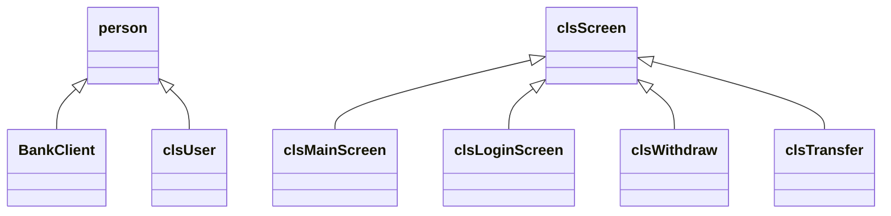
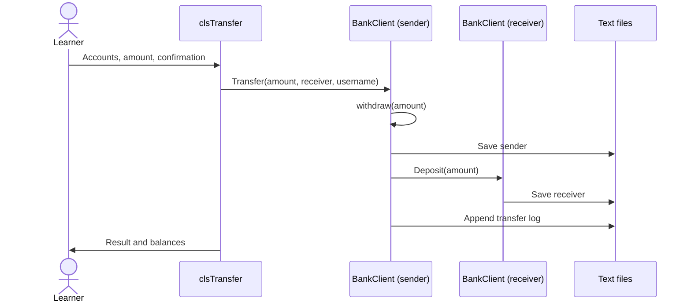

# Architecture and OOP

## Responsibilities

bank-pro groups code into models, screens, and utility libraries. Most methods are implemented inside class definitions in headers. `src/Main.cpp` is the application's compilation entry point; the files in `examples/` are commented exercises and are not compiled into the app.

| Component | Responsibility |
| --- | --- |
| `person` | Store first name, last name, email, and phone; expose accessors and a full name. |
| `BankClient` | Add account number, PIN, and balance; find, save, delete, and perform transactions. |
| `clsUser` | Add username, password, and permission flags; manage accounts and login history. |
| `clsScreen` | Provide shared headers showing the current user/date and a permission-check helper. |
| Screen classes | Read input, display records, request confirmation, and call model operations. |
| `Global.h` | Hold `CurrentUser`, shared by the login flow, screens, and transaction logging. |
| `clsInputValidate` | Read values and provide numeric/date range checks. |
| `clsString` | Split, join, and manipulate strings. |
| `clssDate` | Format dates and implement calendar calculations. |
| `clsUtil` | Provide random values, swaps, character shifting, and number-to-text conversion. |

## Inheritance



`BankClient` and `clsUser` use public inheritance: each includes the personal information supplied by `person`. Screen inheritance is generally protected or private, making common screen helpers available to derived classes without exposing them as the screen's public interface.

The diagram shows representative screens; client management, user management, and other transaction screens follow the same pattern. The classes do not use virtual dispatch. Functions such as `Print()` are called according to their static types rather than through a virtual interface.

## Encapsulation and abstraction

An account balance is stored in the private `_accountBalance` field. A withdrawal screen calls a public operation:

```cpp
BankClient Client = BankClient::Find(AccountNumber);
if (Client.withdraw(Amount))
{
    cout << Client.AccountBalance();
}
```

The screen does not perform the file rewrite. `withdraw()` checks available funds, changes the balance, and calls `Save()`.

The models also expose setters, so encapsulation here demonstrates access control and method-based interaction; it does not enforce every possible domain invariant. For example, a public balance setter can change the balance directly.

## Object state and persistence

Each model uses an enum to distinguish an empty object, an existing record, and a new record:

- `Find()` returns an existing object when it finds a match, or an empty object otherwise.
- `IsEmpty()` lets callers inspect that result.
- A new-object factory creates an object that can be filled in and saved.
- `Save()` appends a new record or updates an existing record according to the mode.
- Delete marks the matching record, rewrites the collection without it, and empties the in-memory object.

Models own both business operations and persistence. This keeps each flow easy to follow, though it means the models are coupled to the text-file format. A useful future exercise is extracting storage into a separate repository class.

## Login and permissions

`Main.cpp` repeatedly shows the login screen. Successful authentication updates `CurrentUser`, appends a login record, and opens the main menu. Logging out empties the current user and returns to the login loop. The login screen ends the loop after three failed attempts.

Permissions are integer bit flags. `CheckAccessPermission()` grants access when all requested bits are present; `-1` grants all permissions. `clsScreen::CheckAccessRights()` displays an access-denied message when needed. Transaction and user management permissions are checked at their menu entry points; other top-level features check their associated permissions.

## Transfer flow



The destination is passed by reference so its in-memory balance is updated along with the saved record. The two saves and log append are separate operations; there is no atomic transaction or rollback.

## Current limitations and exercises

These details are useful starting points for learning through improvement:

1. **Validation:** deposit, withdrawal, and transfer operations do not consistently reject nonpositive values. Same-account transfers are allowed and can produce incorrect balances. Add model-level invariants and test boundary cases.
2. **Money:** balances use `float`, while some inputs use `double`. Transfer logs are parsed with `stoi`, losing fractional values. Consider integer minor units and consistent parsing.
3. **Logs:** sender and receiver balance member names are reversed relative to their serialized positions. The log display follows those positions, but the names are misleading. Make field names and serialization agree.
4. **Persistence:** malformed records can cause indexing or conversion failures. File-write failures are not reliably propagated, and transfers can partially save. Add explicit errors and an atomic persistence strategy.
5. **Credentials:** passwords use a reversible character shift; PINs are stored directly. The encryption/decryption loops write to the string terminator. Screens may display credentials. Study proper authentication design before adapting this to real accounts.
6. **Navigation:** returning to menus makes recursive calls. Refactor the menu flow to loops and handle end-of-input explicitly.
7. **Library edge cases:** date and utility methods include comments identifying behavior to investigate. For example, the default date constructor assigns the month value to the day field.
8. **Shared state:** `CurrentUser` is defined in a header for this single-translation-unit application. Splitting the program into multiple translation units requires an appropriate shared-state declaration/definition strategy.

For each exercise, write down the expected behavior first, then validate both a normal interaction and a relevant edge case. Keep changes small enough to explain which OOP principle they demonstrate.
